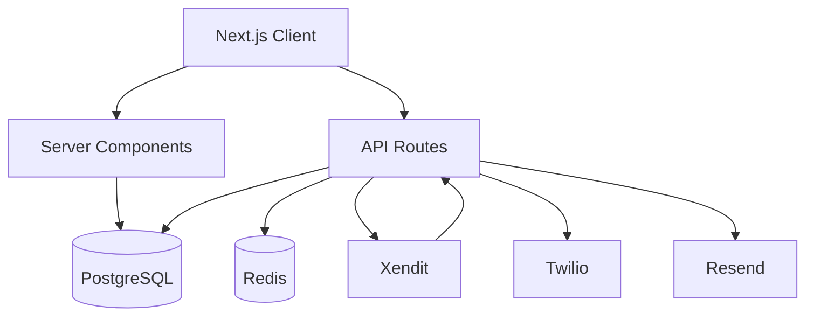
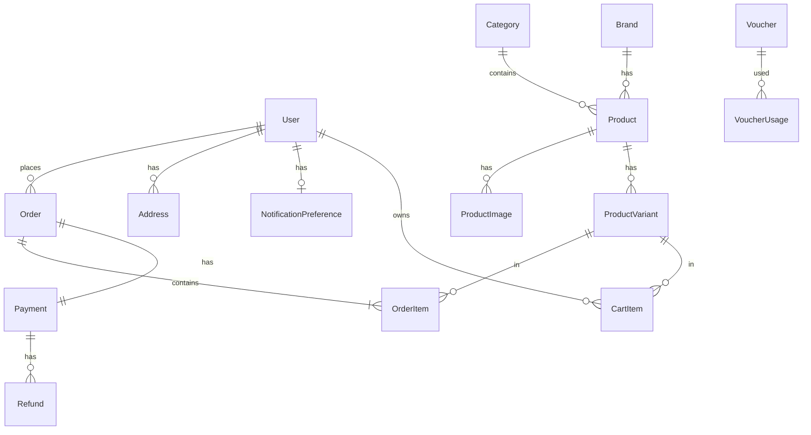

# SDD — Software Design Document — FlexStore

> Fungsi dokumen: menerjemahkan kebutuhan menjadi rancangan teknis yang bisa diikuti agent. SDD menjadi acuan untuk stack, arsitektur, batas modul, data, kontrak, project structure, dan cara menjalankan serta memeriksa sistem.

## 1. Identitas dan dasar rancangan

| Isian | Jawaban |
| --- | --- |
| Nama proyek | FlexStore |
| Versi / tanggal SDD | v1.0 / 2026-10-09; diselaraskan 2026-10-11 dan 2026-10-13 |
| Status rancangan | Finalized — mengikuti implementasi PH-01..PH-10 |
| Versi PRD dan fitur yang dirujuk | PRD v1.6 (2026-10-13) — MVP scope section 3.1, Modules section 4 |
| Penanggung jawab keputusan teknis | Development Team |

## 2. Tech stack dan referensi

| Bagian | Teknologi | Versi | Alasan | Dokumentasi | Status |
| --- | --- | --- | --- | --- | --- |
| Framework | Next.js | 16.3+ | Turbopack (2-5x faster), App Router, RSC, `use cache` | https://nextjs.org/docs | Ditetapkan |
| UI Library | React | 19.2 | React Compiler (built-in), RSC | https://react.dev | Ditetapkan |
| Admin UI | shadcn/ui | Latest | Modern, Tailwind-based | https://ui.shadcn.com | Ditetapkan |
| Styling | Tailwind CSS | 3.x | Utility-first | https://tailwindcss.com | Ditetapkan |
| Database | PostgreSQL | 15.x | ACID, relational | https://postgresql.org/docs/15 | Ditetapkan |
| DB Hosting | Supabase | Cloud | Unlimited compute, pooler | https://supabase.com/docs | Ditetapkan |
| Cache | Redis | 7.x | Locks, sessions, cache | https://redis.io/docs | Ditetapkan |
| Redis Hosting | Upstash | Cloud | Serverless Redis | https://upstash.com/docs | Ditetapkan |
| ORM | Prisma | 5.x | Type-safe, migrations | https://prisma.io/docs | Ditetapkan |
| Hosting | Vercel | Cloud | Serverless, edge | https://vercel.com/docs | Ditetapkan |
| Payment | Xendit | Latest | QRIS, VA, E-Wallet | https://developers.xendit.co | Ditetapkan |
| Shipping | RajaOngkir/Biteship | Latest | Real-time rates | rajaongkir.com/dokumentasi | Ditetapkan |
| OTP | Twilio Verify | Latest | SMS | https://twilio.com/docs | Ditetapkan |
| Email | Resend | Latest | Modern API, React Email | https://resend.com/docs | Ditetapkan |
| File Storage | Uploadthing | Latest | Next.js native, S3-backed | https://docs.uploadthing.com | Ditetapkan |
| Validation | Zod | 3.x | Type-safe validation | https://zod.dev | Ditetapkan |
| Auth | NextAuth.js | 5.x beta | App Router support | https://authjs.dev | Ditetapkan |
| PDF | Dialog cetak browser (HTML siap-cetak) | - | Invoice HTML + `window.print()`, tanpa dependensi baru | https://developer.mozilla.org/docs/Web/API/Window/print | Ditetapkan |
| Testing | Vitest | Latest | Fast unit tests | https://vitest.dev | Asumsi sementara |
| E2E | Playwright | Latest | Browser automation | https://playwright.dev | Asumsi sementara |

**Dependency utama:**
```json
{
  "next": "16.4.0",
  "react": "19.3.0",
  "@prisma/client": "^5.22.0",
  "next-auth": "5.0.0-beta.25",
  "zod": "^3.24.1",
  "@upstash/redis": "^1.34.3",
  "uploadthing": "^7.4.0",
  "twilio": "^5.3.5"
}

Xendit, Resend, dan RajaOngkir dipanggil lewat `fetch` tanpa SDK (lihat bagian 9).
```

**Batas layanan (checked 2026-10-09):**
- Vercel Hobby: Free, 10s timeout, 4500 build min/month
- Supabase Free: 500MB DB, unlimited compute
- Upstash Free: 10k commands/day
- Uploadthing Free: 2GB storage, 2GB bandwidth/month
- Resend Free: 100 emails/day, 3k/month
- Twilio: Sandbox gratis dev, prod ~Rp450-600/SMS
- Xendit: No monthly fee, per-transaction only
- RajaOngkir: Free 1000 req/month

**Kompatibilitas (verified 2026-10-09):**
- Next.js 16.3 stable (latest) with Turbopack default, React Compiler ✓
- Next.js 16 requires React 19.2 ✓
- Prisma 5 supports PostgreSQL 15 ✓
- NextAuth v5 masih beta; mendukung App Router ✓ (repo pin `5.0.0-beta.25`; v5 belum rilis stabil)
- Uploadthing v7+ supports Next.js 16 ✓

## 3. Arsitektur sistem

| Komponen | Tanggung jawab | Komunikasi | Cara | Dikelola |
| --- | --- | --- | --- | --- |
| Next.js Client | UI rendering, interaction | Server, API Routes | Fetch API | Aplikasi |
| Server Components | SSR, data fetching | Prisma, Redis, APIs | Direct calls | Aplikasi |
| API Routes | REST, webhooks | DB, Redis, External | HTTP, SDK | Aplikasi |
| PostgreSQL | Permanent data | Prisma | SQL via pooler | Supabase |
| Redis | Temp data (locks, cache) | API Routes | SDK | Upstash |
| Prisma | DB abstraction | PostgreSQL | Connection pooler | Aplikasi |
| Xendit | Payment, webhook | API Routes | Webhook, SDK | Xendit |
| Twilio | OTP delivery | API Routes | SDK | Twilio |
| Resend | Email notifications | API Routes | SDK | Resend |
| Shipping API | Shipping cost | API Routes | REST | Provider |
| Uploadthing | File storage | Client, API | SDK | Uploadthing |
| NextAuth.js | Auth, sessions | Prisma, API | Middleware | Aplikasi |
| Vercel Edge | CDN, serverless | Next.js | Auto deploy | Vercel |

**Alur Guest Checkout:**
1. Client → Server Component → Prisma → PostgreSQL (fetch products)
2. Client → `/api/cart` → Prisma (stock check)
3. Client → `/api/otp/send` → Twilio Verify
4. Client → `/api/otp/verify` → Redis (penanda nomor terverifikasi)
5. Client → `/api/orders/create` → Prisma (stok dipotong atomik + Order WAITING_PAYMENT, reservasi stok)
6. Client → `/api/payments/create` → Xendit Invoice API (invoice_url, hosted page)
7. Xendit → Webhook `/api/webhooks/xendit` → Prisma (update Payment + Order)
8. Webhook EXPIRED → Prisma (Order CANCELED + stok dikembalikan)

**Aturan bisnis ditegakkan:**
- Stock validation: Server-side API (client UX only)
- Payment verify: verifikasi header `x-callback-token`
- Voucher calc: Server-side API
- Role auth: NextAuth middleware
- Idempotency: klaim baris `Payment` di database (`updateMany` bersyarat)

**Batas kepercayaan:**
- Input: Zod validation API Routes
- Webhook: verifikasi `x-callback-token`
- Auth: NextAuth token verify
- Authorization: Role check middleware

**Diagram:**



## 4. Rancangan per modul

### 4.1. MOD-AUTH — Authentication & Authorization

| Bagian | Rancangan |
| --- | --- |
| Tanggung jawab | User auth, session mgmt, RBAC, OTP verification, password reset |
| Di luar tanggung jawab | Product/order/payment logic |
| Fitur yang dilayani | PRD 4.1: Authentication & Authorization |
| Komponen UI | Login, register, OTP verify, password reset forms |
| Komponen backend | NextAuth providers, `/api/auth/[...nextauth]`, `/api/otp/*`, `proxy.ts` |
| Data yang dikelola | User, Session, Account, VerificationToken, OTP codes (Redis) |
| Antarmuka | `getServerSession()`, `signIn()`, `signOut()`, `sendOTP()`, `verifyOTP()` |
| Ketergantungan | Redis, Twilio, Prisma |
| Lokasi kode | `/src/lib/auth/`, `/src/app/api/auth/`, `/src/proxy.ts` |

### 4.2. MOD-PROD — Product Management

| Bagian | Rancangan |
| --- | --- |
| Tanggung jawab | Product CRUD, category, brand, variant, stock, images |
| Di luar tanggung jawab | Order/cart logic, stock reservation (MOD-ORDER) |
| Fitur yang dilayani | PRD 3.1.A: Catalog & Product Management |
| Komponen UI | Product list, detail, admin CRUD, category/brand CRUD, image upload |
| Komponen backend | Server Components, `/api/admin/products`, Server Actions |
| Data yang dikelola | Product, Category, Brand, ProductVariant, ProductImage, stock |
| Antarmuka | `getProducts()`, `getProductBySlug()`, `createProduct()`, `updateStock()` |
| Ketergantungan | Uploadthing, Prisma |
| Lokasi kode | `/src/app/(storefront)/products/`, `/src/app/admin/products/`, `/src/lib/products/` |

### 4.3. MOD-CART — Shopping Cart

| Bagian | Rancangan |
| --- | --- |
| Tanggung jawab | Cart session, add/update/remove, stock/price validation |
| Di luar tanggung jawab | Checkout, order creation, payment |
| Fitur yang dilayani | PRD 3.1.B: Shopping Cart |
| Komponen UI | Cart page, drawer, quantity controls |
| Komponen backend | Context/Zustand, `/api/cart/validate`, `/api/cart/sync` |
| Data yang dikelola | CartItem (Redis for guest, PostgreSQL for customer) |
| Antarmuka | `addToCart()`, `updateCartItem()`, `removeFromCart()`, `validateCart()` |
| Ketergantungan | MOD-PROD, Redis, Prisma |
| Lokasi kode | `/src/app/(storefront)/cart/`, `/src/lib/cart/`, `/src/contexts/CartContext.tsx` |

### 4.4. MOD-ORDER — Order Management

| Bagian | Rancangan |
| --- | --- |
| Tanggung jawab | Create order, status tracking, stock reservation, history, cancellation |
| Di luar tanggung jawab | Payment processing, shipping calc, voucher calc |
| Fitur yang dilayani | PRD 3.1.C: Checkout & Order, PRD 5.1: Stock Management |
| Komponen UI | Checkout, order confirmation, history, admin order mgmt |
| Komponen backend | `/api/orders/create`, `/api/orders/[id]`, `/api/admin/orders` |
| Data yang dikelola | Order, OrderItem, order status |
| Antarmuka | `createOrder()`, `updateOrderStatus()`, `reserveStock()`, `releaseStock()` |
| Ketergantungan | MOD-CART, MOD-PROD (stok atomik via Prisma), MOD-PAY, MOD-SHIP, MOD-VOUCH |
| Lokasi kode | `/src/app/(storefront)/checkout/`, `/src/app/admin/orders/`, `/src/lib/orders/` |

**Reservasi stok (PH-03):** stok dipotong atomik saat pesanan DIBUAT (`updateMany` dengan syarat `stock >= qty` di dalam `$transaction`, tanpa raw SQL). Reservasi dilepas secara malas (lazy) saat melewati `stockReservedUntil`, atau segera saat webhook Xendit EXPIRED. Batas reservasi = masa bayar invoice (`XENDIT_INVOICE_DURATION`). Pembayaran sukses TIDAK mengurangi stok lagi.

### 4.5. MOD-PAY — Payment

| Bagian | Rancangan |
| --- | --- |
| Tanggung jawab | Xendit integration, payment tracking, webhook, idempotency, refund |
| Di luar tanggung jawab | Order creation, stock mgmt |
| Fitur yang dilayani | PRD 3.1.D: Payment, PRD 5.2: Payment Rules, PRD 3.1.G: Refund |
| Komponen UI | Tombol "Bayar Sekarang", halaman invoice Xendit (hosted page), status pembayaran |
| Komponen backend | `/api/payments/create`, `/api/webhooks/xendit` (refund di PH-06) |
| Data yang dikelola | Payment, status pembayaran (Refund di PH-06) |
| Antarmuka | `createPaymentForOrder()`, `applyPaidPayment()`, `applyExpiredPayment()` |
| Ketergantungan | Xendit Invoice API v2, MOD-ORDER, Prisma |
| Lokasi kode | `/src/lib/payments/`, `/src/app/api/payments/`, `/src/app/api/webhooks/xendit/` |

**Idempotensi webhook (PH-04):** klaim baris `Payment` dengan `updateMany` bersyarat (`status: PENDING`); `count === 0` berarti sudah diproses. Redis tidak dipakai di MOD-PAY.

### 4.6. MOD-VOUCH — Voucher & Promotion

| Bagian | Rancangan |
| --- | --- |
| Tanggung jawab | Voucher CRUD, eligibility, stacking, usage tracking, calculation (bertahap) |
| Di luar tanggung jawab | Order/payment, cart |
| Fitur yang dilayani | PRD 3.1.E: Voucher & Promotion, PRD 5.3: Voucher Calculation |
| Komponen UI | Voucher input (checkout), admin CRUD, stacking matrix |
| Komponen backend | `/api/vouchers/validate`, `/api/vouchers/apply`, `/api/admin/vouchers` |
| Data yang dikelola | Voucher, VoucherCompatibility, VoucherUsage |
| Antarmuka | `validateVoucher()`, `applyVouchers()`, `calculateDiscount()`, `checkStacking()` |
| Ketergantungan | MOD-CART, MOD-ORDER, MOD-SHIP, Prisma |
| Lokasi kode | `/src/lib/vouchers/`, `/src/app/api/vouchers/`, `/src/app/admin/vouchers/` |

**Calculation:** Sort nominal first → percentage. Sequential: nominal → percentage (seller-oriented).

### 4.7. MOD-SHIP — Shipping

| Bagian | Rancangan |
| --- | --- |
| Tanggung jawab | Shipping API integration, cost calc, tracking, pickup |
| Di luar tanggung jawab | Order mgmt, payment |
| Fitur yang dilayani | PRD 3.1.F: Shipping |
| Komponen UI | Shipping method selection, cost display, tracking page |
| Komponen backend | `/api/shipping/calculate`, `/api/shipping/track`, fallback flat rate |
| Data yang dikelola | Kolom pengiriman pada `Order` (`courier`, `service`, `shippingCost`, `trackingNumber`, `shippedAt`, `fulfillment`); tanpa model `Shipping` terpisah |
| Antarmuka | `calculateShippingCost()`, `getShippingOptions()`, `trackShipment()` |
| Ketergantungan | RajaOngkir API, MOD-ORDER, Redis (cache 5-10 min) |
| Lokasi kode | `/src/lib/shipping/`, `/src/app/api/shipping/` |

**Error handling:** Timeout 10s, fallback flat rate, cache result Redis.

### 4.8. MOD-CUST — Customer Management

| Bagian | Rancangan |
| --- | --- |
| Tanggung jawab | Profil akun customer (nama, email, ubah password), alamat tersimpan (maks 5), riwayat pesanan |
| Di luar tanggung jawab | Autentikasi (MOD-AUTH), pembuatan pesanan (MOD-ORDER); formulir preferensi notifikasi (MOD-NOTIF NOTIF-02 — dibaca di sini saat kirim lewat CUST-02) |
| Fitur yang dilayani | PRD 4.8: Customer Management, PRD 5.8: Customer Address; CUST-01, CUST-03 (`docs/03`) |
| Komponen UI | Halaman `/profile` (akun: CUST-03) dan `/profile/addresses` (alamat: CUST-01), CRUD alamat, riwayat pesanan di `/orders` |
| Komponen backend | Server Components, `/api/customer/addresses`, `/api/customer/addresses/[id]` |
| Data yang dikelola | `User` (profil), `Address` (maks 5); preferensi notifikasi dibaca lewat helper MOD-CUST (`getNotificationPreferences`, `shouldSendNotification`) |
| Antarmuka | `getAddresses()`, `getAddressById()`, `countAddresses()`, `createAddress()`, `updateAddress()`, `deleteAddress()`, `getNotificationPreferences()`, `updateNotificationPreferences()` |
| Ketergantungan | MOD-AUTH, MOD-ORDER, MOD-NOTIF (preferensi), Prisma |
| Lokasi kode | `/src/app/(storefront)/profile/`, `/src/lib/customers/` |

### 4.9. MOD-NOTIF — Notification

| Bagian | Rancangan |
| --- | --- |
| Tanggung jawab | Email transaksional: konfirmasi pesanan, pembayaran sukses, pesanan dikirim, pembatalan (approve/reject), refund selesai, set password (klaim akun guest, AUTH-04), reset password (AUTH-05) |
| Di luar tanggung jawab | Pengiriman OTP (MOD-AUTH via Twilio SMS); penyimpanan pilihan preferensi customer (MOD-CUST CUST-02 — dibaca di sini saat kirim) |
| Fitur yang dilayani | PRD 3.1.I: Email Notification, PRD 4.9; NOTIF-01 (`docs/04` bagian 8 dan 9), NOTIF-02 (PH-10: pusat notifikasi in-app) |
| Komponen UI | Template email `src/emails/` (7 jenis + `layout.ts` bersama); ikon notifikasi + dialog (daftar + pengaturan preferensi) di navbar — dipindah dari `/profile` pada PH-10 (NOTIF-02) |
| Komponen backend | `src/lib/notifications/` (`order-emails.ts`, `account-emails.ts`, `email.ts`, `config.ts`); Resend HTTP API lewat `fetch` (tanpa SDK); tanpa route `/api/notifications/*` |
| Data yang dikelola | Tanpa log email (hanya `console.error` di server); token set/reset password di Redis (`src/lib/auth/tokens.ts`); penanda notifikasi terakhir dilihat `notif:last-seen:{userId}` di Redis (PH-10 — tanpa tabel baru) |
| Antarmuka | `sendOrderConfirmationEmail()`, `sendPaymentSuccessEmail()`, `sendOrderShippedEmail()`, `sendCancellationEmail()`, `sendRefundCompletedEmail()`, `sendSetPasswordEmailForOrder()`, `sendPasswordResetEmail()` |
| Ketergantungan | Resend (opsional — tanpa `RESEND_API_KEY` email dilewati), MOD-ORDER, MOD-PAY, MOD-AUTH, MOD-CUST (preferensi) |
| Lokasi kode | `/src/lib/notifications/`, `/src/emails/`, `/src/app/api/auth/forgot-password/` |

**Aturan pengiriman:**

- Semua pengiriman **non-blocking**: kegagalan hanya dicatat di log server dan tidak membatalkan alur pesanan/pembayaran (SDD 4.9, PRD 3.1.I).
- Dilewati seluruhnya bila `isEmailConfigured()` false (tanpa `RESEND_API_KEY`).
- Lima email pesanan diperiksa `shouldSendNotification(userId, kind)` (CUST-02): preferensi customer dihormati per jenis; guest (`userId = null`) selalu dikirimi; kegagalan baca preferensi dianggap aktif.
- Email set/reset password **tidak** tunduk preferensi (email keamanan akun yang diminta langsung pengguna).
- Penerima: `Order.guestEmail` (guest) atau email customer pemilik pesanan; set password → `Order.guestEmail`, reset password → email user terdaftar.
- Email pembayaran hanya saat pembayaran benar-benar baru diproses (`APPLIED`) — termasuk lewat rekonsiliasi status ke Xendit; webhook ulang tidak mengirim.
- Tautan pelacakan berbeda per pembeli: customer → `/orders/[id]/tracking`, guest → `/track-order`.
- **Pusat notifikasi in-app (NOTIF-02, PH-10 — rencana):** ikon lonceng di navbar membuka dialog berisi daftar notifikasi + pengaturan preferensi email. Daftar notifikasi **diturunkan dari data pesanan**, bukan tabel `Notification` baru: (1) pesanan dibuat dan belum dibayar (`Order.status = WAITING_PAYMENT`), (2) pesanan terkirim pertama kali (`Order.shippedAt`), (3) pesanan sudah tiba (`Order.completedAt`), (4) pesanan dibatalkan sebelum bayar (`Order.canceledAt` tanpa pembayaran `PAID`), (5) refund selesai (`Refund.status = COMPLETED`). Badge "belum dibaca" dihitung dari kejadian yang lebih baru daripada `notif:last-seen:{userId}`; penanda di-set saat dialog dibuka. Tautan tiap notifikasi mengarah ke `/orders/[id]` atau `/orders/[id]/tracking`; guest tidak punya ikon ini (tanpa akun) dan tetap memakai email.

### 4.10. MOD-INV — Invoice

| Bagian | Rancangan |
| --- | --- |
| Tanggung jawab | Invoice generation, view, PDF download |
| Di luar tanggung jawab | Order/payment data (read-only) |
| Fitur yang dilayani | PRD 3.1.I: Invoice |
| Komponen UI | Invoice view, tombol cetak/simpan PDF (`PrintButton`) |
| Komponen backend | Server Component `/orders/[id]/invoice` (HTML siap-cetak, `window.print()`) |
| Data yang dikelola | Invoice (generated on-demand) |
| Antarmuka | `buildOrderConfirmationEmail()`, `buildPaymentSuccessEmail()` |
| Ketergantungan | MOD-ORDER, MOD-PAY |
| Lokasi kode | `/src/app/(storefront)/orders/[id]/invoice/`, `/src/components/invoices/` |

> **Revisi PH-05 (2026-10-10):** invoice tidak memakai `@react-pdf/renderer`. Dipakai halaman HTML siap-cetak supaya tidak menambah dependensi berat; PDF dihasilkan lewat dialog cetak browser. Lihat `docs/04` bagian 10.

### 4.11. MOD-REPORT — Reporting

| Bagian | Rancangan |
| --- | --- |
| Tanggung jawab | Sales report, product performance, stock/order/refund reports |
| Di luar tanggung jawab | Real-time analytics, advanced visualization |
| Fitur yang dilayani | PRD 3.1.K: Admin & Reporting |
| Komponen UI | Admin dashboard, report pages, date filters |
| Komponen backend | Server Components, Prisma aggregation queries |
| Data yang dikelola | Read-only aggregations from Order, Payment, Product, Refund |
| Antarmuka | `getSalesReport()`, `getProductPerformance()`, `getStockReport()` |
| Ketergantungan | Prisma, MOD-ORDER, MOD-PAY, MOD-PROD |
| Lokasi kode | `/src/app/admin/reports/`, `/src/lib/reports/` |

### 4.12. MOD-CONFIG — Store Configuration (Store Admin)

| Bagian | Rancangan |
| --- | --- |
| Tanggung jawab | Info toko, kebijakan operasional, template alasan pembatalan, opsi pickup |
| Di luar tanggung jawab | Konfigurasi tingkat platform (MOD-SITE), data produk/pesanan |
| Fitur yang dilayani | PRD 3.1.J/4.12: Store Customization + CONFIG-01 (`docs/03`) |
| Komponen UI | Form `/admin/settings`, daftar template `/admin/cancellation-reasons` |
| Komponen backend | Server Components, `GET`/`PATCH /api/admin/settings`, `/api/admin/cancellation-reasons` |
| Data yang dikelola | `StoreSetting` (singleton), `CancellationReason` |
| Antarmuka | `getStoreSettings()`, `updateStoreSettings()`, `getCancellationReasons()` |
| Ketergantungan | Prisma |
| Lokasi kode | `/src/app/admin/settings/`, `/src/app/admin/cancellation-reasons/`, `/src/lib/config/` |

### 4.13. MOD-SITE — Platform Configuration (Site Admin)

| Bagian | Rancangan |
| --- | --- |
| Tanggung jawab | Konfigurasi tingkat platform (mode pemeliharaan, status pendaftaran), konfigurasi payment gateway dan shipping provider, kelola akun Store Admin; PH-09 menambah kustomisasi brand |
| Di luar tanggung jawab | Data produk/pesanan; info toko operasional (MOD-CONFIG) |
| Fitur yang dilayani | PRD 2.4/3.1.K: SITE-00..SITE-04 (`docs/03`), SITE-05 (PH-09) |
| Komponen UI | Area `/site-admin/*` (settings, payment, shipping, users) + sidebar platform; PH-09 menambah `/site-admin/brand` |
| Komponen backend | Server Components, `GET`/`PATCH /api/site-admin/{platform-settings,payment-settings,shipping-settings}`, `GET`/`POST`/`PATCH /api/site-admin/users`; PH-09 `GET`/`PATCH /api/site-admin/brand` |
| Data yang dikelola | `PlatformSetting` (singleton), `User` (akun Store Admin); PH-09 `BrandSetting` (singleton) |
| Antarmuka | `getPlatformSettings()`, `updatePlatformSettings()`, `listStoreAdmins()`, `createStoreAdmin()`, `setStoreAdminActive()`, `resetStoreAdminPassword()` |
| Ketergantungan | Prisma, NextAuth (role `SITE_ADMIN`), PH-09: Uploadthing |
| Lokasi kode | `/src/app/site-admin/`, `/src/app/api/site-admin/`, `/src/lib/platform/` |

## 5. Project Structure

**Konvensi:** Idiomatic Next.js 16 App Router structure mengikuti ecosystem best practices.

**Next.js 16 App Router Patterns:**
- **File-based routing** (`/src/app/`) — folder = route segment, `page.tsx` = UI, `layout.tsx` = shared wrapper
- **Route Groups** (`(storefront)`, `(auth)`, `admin`, `site-admin`) — organize routes tanpa affect URL path
- **Server Components default** — all components di `/src/app/` are Server Components kecuali marked `'use client'`
- **API Routes** (`/src/app/api/`) — serverless functions via Route Handlers (Next.js 13+)
- **Colocation** — `loading.tsx`, `error.tsx`, `not-found.tsx` co-located dengan routes
- **Metadata API** — `metadata` export di `layout.tsx`/`page.tsx` untuk SEO
- **Server Actions** — form actions via `'use server'` (optional, API Routes preferred untuk external integrations)

**Grouping Strategy:**
- **Feature-based** (`/src/lib/`) — business logic, data access, utilities
- **Route-based** (`/src/app/`) — UI pages dan API endpoints
- **Component-based** (`/src/components/`) — reusable UI components

```
flexstore/
├── prisma/
│   ├── schema.prisma              # Prisma schema (DB entities)
│   ├── migrations/                # DB migrations
│   └── seed.ts                    # Seed data script
├── src/
│   ├── app/                       # Next.js 16 App Directory (file-based routing)
│   │   ├── (auth)/                # Route group: login, register, lupa/reset password, set password
│   │   ├── (storefront)/          # Route group: Customer-facing routes (no '/storefront' in URL)
│   │   │   ├── page.tsx           # Homepage: `/`
│   │   │   ├── layout.tsx         # Storefront layout (header, footer)
│   │   │   ├── loading.tsx        # Loading UI (Suspense boundary)
│   │   │   ├── products/
│   │   │   │   ├── page.tsx       # Product list: `/products`
│   │   │   │   └── [slug]/
│   │   │   │       └── page.tsx   # Product detail: `/products/[slug]`
│   │   │   ├── cart/
│   │   │   │   └── page.tsx       # Cart: `/cart`
│   │   │   ├── checkout/
│   │   │   │   └── page.tsx       # Checkout: `/checkout`
│   │   │   ├── orders/
│   │   │   │   ├── page.tsx       # Order history: `/orders`
│   │   │   │   └── [id]/
│   │   │   │       ├── page.tsx   # Order detail: `/orders/[id]`
│   │   │   │       ├── invoice/
│   │   │   │       │   └── page.tsx # Invoice: `/orders/[id]/invoice`
│   │   │   │       └── tracking/
│   │   │   │           └── page.tsx # Tracking detail customer (ORDER-08): `/orders/[id]/tracking`
│   │   │   ├── profile/
│   │   │   │   ├── page.tsx       # Profil akun (CUST-03, PH-10): `/profile`
│   │   │   │   └── addresses/
│   │   │   │       └── page.tsx   # Alamat tersimpan (CUST-01): `/profile/addresses`
│   │   │   └── track-order/
│   │   │       └── page.tsx       # Lacak pesanan: `/track-order` — guest isi form (ORDER-04); customer login lihat daftar pesanan dalam perjalanan (ORDER-08)
│   │   ├── admin/                 # Admin routes (protected by proxy.ts)
│   │   │   ├── page.tsx           # Admin dashboard: `/admin`
│   │   │   ├── layout.tsx         # Admin layout (sidebar, auth check)
│   │   │   ├── products/
│   │   │   │   ├── page.tsx       # Product list admin: `/admin/products`
│   │   │   │   ├── new/
│   │   │   │   │   └── page.tsx   # Add product: `/admin/products/new`
│   │   │   │   └── [id]/
│   │   │   │       └── edit/
│   │   │   │           └── page.tsx # Edit product: `/admin/products/[id]/edit`
│   │   │   ├── orders/
│   │   │   │   ├── page.tsx       # Order management: `/admin/orders`
│   │   │   │   └── [id]/
│   │   │   │       └── page.tsx   # Order detail admin: `/admin/orders/[id]`
│   │   │   ├── vouchers/
│   │   │   │   ├── page.tsx       # Voucher list: `/admin/vouchers`
│   │   │   │   ├── new/
│   │   │   │   │   └── page.tsx   # Add voucher: `/admin/vouchers/new`
│   │   │   │   └── [id]/
│   │   │   │       └── edit/
│   │   │   │           └── page.tsx # Edit voucher: `/admin/vouchers/[id]/edit`
│   │   │   ├── reports/
│   │   │   │   └── page.tsx       # Sales reports: `/admin/reports`
│   │   │   └── settings/
│   │   │       └── page.tsx       # Store settings: `/admin/settings`
│   │   ├── site-admin/            # Site Admin routes (protected by proxy.ts)
│   │   │   ├── page.tsx           # Dasbor platform: `/site-admin`
│   │   │   ├── layout.tsx         # Layout platform (sidebar, auth check)
│   │   │   ├── settings/
│   │   │   │   └── page.tsx       # Pengaturan platform: `/site-admin/settings`
│   │   │   ├── payment/
│   │   │   │   └── page.tsx       # Konfigurasi pembayaran: `/site-admin/payment`
│   │   │   ├── shipping/
│   │   │   │   └── page.tsx       # Konfigurasi ongkir: `/site-admin/shipping`
│   │   │   └── users/
│   │   │       └── page.tsx       # Kelola Store Admin: `/site-admin/users`
│   │   ├── api/                   # API Routes (Route Handlers)
│   │   │   ├── auth/
│   │   │   │   └── [...nextauth]/ # NextAuth v5 catch-all route
│   │   │   │       └── route.ts   # NextAuth handlers: `/api/auth/*`
│   │   │   ├── otp/
│   │   │   │   ├── send/
│   │   │   │   │   └── route.ts   # Send OTP: POST `/api/otp/send`
│   │   │   │   └── verify/
│   │   │   │       └── route.ts   # Verify OTP: POST `/api/otp/verify`
│   │   │   ├── cart/
│   │   │   │   └── route.ts       # Cart operations: GET/POST/PATCH/DELETE `/api/cart`
│   │   │   ├── orders/
│   │   │   │   ├── route.ts       # Create order: POST `/api/orders`
│   │   │   │   └── [id]/
│   │   │   │       └── route.ts   # Order detail: GET/PATCH `/api/orders/[id]`
│   │   │   ├── payments/
│   │   │   │   └── route.ts       # Create payment: POST `/api/payments`
│   │   │   ├── webhooks/
│   │   │   │   └── xendit/
│   │   │   │       └── route.ts   # Xendit webhook: POST `/api/webhooks/xendit`
│   │   │   ├── shipping/
│   │   │   │   └── route.ts       # Calculate shipping: POST `/api/shipping`
│   │   │   ├── vouchers/
│   │   │   │   ├── validate/
│   │   │   │   │   └── route.ts   # Validate voucher: POST `/api/vouchers/validate`
│   │   │   │   └── route.ts       # Apply voucher: POST `/api/vouchers`
│   │   │   ├── admin/
│   │   │   │   ├── products/
│   │   │   │   │   ├── route.ts   # Admin product CRUD: GET/POST `/api/admin/products`
│   │   │   │   │   └── [id]/
│   │   │   │   │       └── route.ts # Admin product detail: GET/PATCH/DELETE `/api/admin/products/[id]`
│   │   │   │   ├── categories/
│   │   │   │   │   └── route.ts   # Category CRUD: GET/POST/PATCH/DELETE `/api/admin/categories`
│   │   │   │   └── brands/
│   │   │   │       └── route.ts   # Brand CRUD: GET/POST/PATCH/DELETE `/api/admin/brands`
│   │   │   ├── site-admin/
│   │   │   │   ├── platform-settings/
│   │   │   │   │   └── route.ts   # Platform settings: GET/PATCH `/api/site-admin/platform-settings`
│   │   │   │   ├── payment-settings/
│   │   │   │   │   └── route.ts   # Konfigurasi Xendit: GET/PATCH `/api/site-admin/payment-settings`
│   │   │   │   ├── shipping-settings/
│   │   │   │   │   └── route.ts   # Konfigurasi RajaOngkir: GET/PATCH `/api/site-admin/shipping-settings`
│   │   │   │   └── users/
│   │   │   │       └── route.ts   # Akun Store Admin: GET/POST/PATCH `/api/site-admin/users`
│   │   │   └── uploadthing/
│   │   │       └── route.ts       # Uploadthing handler: POST `/api/uploadthing`
│   │   ├── layout.tsx             # Root layout (global metadata, font, Providers)
│   │   ├── error.tsx              # Global error boundary
│   │   └── not-found.tsx          # 404 page
│   ├── components/                # React components (Client + Server)
│   │   ├── ui/                    # shadcn/ui primitives (Button, Input, Card, etc.)
│   │   │   ├── button.tsx
│   │   │   ├── input.tsx
│   │   │   ├── card.tsx
│   │   │   └── ...
│   │   ├── layout/                # Layout components
│   │   │   ├── Header.tsx
│   │   │   ├── Footer.tsx
│   │   │   ├── PageContainer.tsx  # Wrapper lebar konten storefront (max-w-6xl)
│   │   │   ├── NotificationBell.tsx # Ikon notifikasi + dialog daftar & pengaturan (NOTIF-02, PH-10)
│   │   │   └── Sidebar.tsx
│   │   ├── products/              # Product-related components
│   │   │   ├── ProductCard.tsx
│   │   │   ├── ProductGrid.tsx
│   │   │   └── ProductForm.tsx
│   │   └── admin/                 # Admin-specific components
│   │       ├── DashboardStats.tsx
│   │       └── DataTable.tsx
│   ├── lib/                       # Business logic, utilities, data access (Server-side only)
│   │   ├── auth/                  # Auth utilities
│   │   │   ├── index.ts           # NextAuth config
│   │   │   ├── session.ts         # getServerSession wrapper
│   │   │   └── otp.ts             # OTP logic (Twilio)
│   │   ├── products/              # Product domain logic
│   │   │   ├── queries.ts         # Prisma queries (getProducts, getProductBySlug)
│   │   │   ├── mutations.ts       # Prisma mutations (createProduct, updateProduct)
│   │   │   └── validation.ts      # Zod schemas
│   │   ├── cart/                  # Cart logic
│   │   │   ├── queries.ts
│   │   │   ├── mutations.ts
│   │   │   └── validation.ts
│   │   ├── orders/                # Order domain logic
│   │   │   ├── queries.ts
│   │   │   ├── mutations.ts
│   │   │   ├── stock.ts           # Reservasi stok (Prisma updateMany atomik)
│   │   │   └── validation.ts
│   │   ├── payments/              # Payment integration
│   │   │   ├── xendit.ts          # Xendit SDK wrapper
│   │   │   ├── client.ts          # Klien Xendit Invoice API v2
│   │   │   └── validation.ts
│   │   ├── vouchers/              # Voucher logic
│   │   │   ├── queries.ts
│   │   │   ├── calculation.ts     # Voucher calculation (bertahap)
│   │   │   └── validation.ts
│   │   ├── shipping/              # Shipping integration
│   │   │   ├── rajaongkir.ts      # RajaOngkir API wrapper
│   │   │   ├── biteship.ts        # Biteship API wrapper (fallback)
│   │   │   └── cache.ts           # Redis cache (5-10 min)
│   │   ├── notifications/         # Notification logic
│   │   │   ├── email.ts           # Resend integration
│   │   │   └── templates.ts       # Email templates
│   │   ├── db/
│   │   │   └── prisma.ts          # Prisma client singleton
│   │   ├── redis/
│   │   │   └── client.ts          # Upstash Redis client
│   │   └── utils/                 # Shared utilities
│   │       ├── format.ts          # Date, currency formatting
│   │       └── cn.ts              # Tailwind class merge (shadcn/ui)
│   ├── emails/                    # React Email templates
│   │   ├── OrderConfirmation.tsx
│   │   └── PaymentSuccess.tsx
│   ├── contexts/                  # React Context providers (Client Components)
│   │   └── CartContext.tsx        # Cart state (optional, prefer Server Components + cookies)
│   ├── hooks/                     # Custom React hooks (Client Components)
│   │   └── useCart.ts
│   ├── types/                     # TypeScript type definitions
│   │   ├── api.ts                 # API response types
│   │   └── database.ts            # Prisma-generated types
│   └── proxy.ts                   # Next.js 16 proxy (auth, redirects)
├── public/                        # Static assets (served from `/`)
│   ├── favicon.ico
│   └── images/
├── .env.local                     # Environment variables (gitignored)
├── .gitignore
├── next.config.js                 # Next.js config
├── tailwind.config.ts             # Tailwind CSS config
├── tsconfig.json                  # TypeScript config
├── components.json                # shadcn/ui config
└── package.json
```

**File Naming Conventions:**
- **Files:** kebab-case (`product-card.tsx`, `auth-utils.ts`)
- **Components:** PascalCase (`ProductCard.tsx`, `Header.tsx`)
- **Functions/Variables:** camelCase (`getProducts`, `userId`)
- **Constants:** UPPER_SNAKE_CASE (`MAX_CART_ITEMS`, `API_BASE_URL`)
- **Types/Interfaces:** PascalCase (`User`, `ProductWithVariants`)

**Next.js 16 Special Files (App Router):**
- `page.tsx` — Route UI (accessible via URL)
- `layout.tsx` — Shared wrapper (persists across navigations)
- `loading.tsx` — Loading UI (Suspense fallback)
- `error.tsx` — Error boundary
- `not-found.tsx` — 404 UI
- `route.ts` — API Route Handler (serverless function)
- `proxy.ts` — Next.js 16 Proxy (Edge, runs before request; pengganti `middleware.ts`)

**Import Rules (Dependency Direction):**
- `/src/app/` (UI) → `/src/lib/` (logic), `/src/components/` (UI components)
- `/src/lib/` (logic) → NO imports from `/src/app/` or `/src/components/` (avoid circular deps)
- `/src/components/` → `/src/lib/utils/`, `shadcn/ui` (UI utilities only)
- API Routes (`/src/app/api/`) → `/src/lib/` (business logic), NO direct Prisma queries in route handlers (use `/src/lib/*/queries.ts`)

## 6. Rancangan data

### 6.1. Entitas dan relasi

| Entitas | Arti | Modul | PK | Relasi |
| --- | --- | --- | --- | --- |
| User | Akun pengguna (customer, Store Admin, Site Admin) | MOD-AUTH | id (UUID) | 1 → N Order, 1 → N Address, 1 → 1 NotificationPreference |
| Address | Alamat tersimpan customer | MOD-CUST | id (UUID) | N → 1 User |
| NotificationPreference | Preferensi notifikasi customer | MOD-NOTIF | id (UUID) | 1 → 1 User |
| Category | Kategori produk | MOD-PROD | id (UUID) | 1 → N Product |
| Brand | Brand produk | MOD-PROD | id (UUID) | 1 → N Product |
| Product | Produk dasar | MOD-PROD | id (UUID) | 1 → N ProductImage, 1 → N ProductVariant, N → 1 Category, N → 1 Brand |
| ProductImage | Gambar produk (peran `GALLERY`/`SIZE_CHART`) | MOD-PROD | id (UUID) | N → 1 Product |
| ProductVariant | Varian (SKU, stok, harga) | MOD-PROD | id (UUID) | N → 1 Product |
| CartItem | Item keranjang customer | MOD-CART | id (UUID) | N → 1 User, N → 1 ProductVariant |
| Order | Pesanan (termasuk data pengiriman: `courier`, `trackingNumber`, `shippedAt`, `fulfillment`) | MOD-ORDER | id (UUID) | 1 → N OrderItem, N → 1 User (nullable), 1 → 1 Payment |
| OrderItem | Baris item pesanan | MOD-ORDER | id (UUID) | N → 1 Order, N → 1 ProductVariant |
| Payment | Catatan pembayaran | MOD-PAY | id (UUID) | 1 → 1 Order, 1 → N Refund |
| Refund | Catatan refund | MOD-PAY | id (UUID) | N → 1 Payment |
| Voucher | Voucher/promosi | MOD-VOUCH | id (UUID) | 1 → N VoucherCompatibility, 1 → N VoucherUsage, 1 → N VoucherProduct, 1 → N VoucherCategory |
| VoucherCompatibility | Kompatibilitas stacking | MOD-VOUCH | id (UUID) | N → 1 Voucher (2 FK) |
| VoucherUsage | Jejak pemakaian | MOD-VOUCH | id (UUID) | N → 1 Voucher, N → 1 Order |
| VoucherProduct | Batas voucher per produk (`ELIGIBLE`/`EXCLUDED`) | MOD-VOUCH | id (UUID) | N → 1 Voucher, N → 1 Product |
| VoucherCategory | Batas voucher per kategori | MOD-VOUCH | id (UUID) | N → 1 Voucher, N → 1 Category |
| StoreSetting | Konfigurasi toko | MOD-CONFIG | id (UUID) | Singleton |
| PlatformSetting | Konfigurasi platform | MOD-SITE | id (UUID) | Singleton |
| CancellationReason | Template alasan pembatalan | MOD-CONFIG | id (UUID) | Standalone |

NextAuth memakai strategi sesi JWT sehingga tidak ada tabel `Session`/`Account`. `BrandSetting` (singleton, PH-09) menyimpan identitas brand per deployment: `brandName`, `tagline`, `logoUrl`, `faviconUrl`, `footerText`, dan palet warna 9 grup (hex, nullable — `null` = nilai bawaan).

### ERD:



### 6.2. Data dictionary (key fields)

**User:**
- id: UUID, PK
- email: String, unique, nullable
- phone: String, unique (OTP)
- password: String, nullable (bcrypt)
- role: Enum (GUEST, CUSTOMER, STORE_ADMIN, SITE_ADMIN)
- name: String

**Product:**
- id: UUID, PK
- name, slug (unique), description
- status: Enum (ACTIVE, INACTIVE, DRAFT, OUT_OF_STOCK, DISCONTINUED)
- categoryId, brandId (nullable)
- totalStock: Int (calculated)

**ProductVariant:**
- id: UUID, PK
- productId: FK
- sku: String, unique
- name, price: Decimal, stock: Int
- weightGram: Int (gram, diisi admin; dipakai server untuk ongkir)
- imageUrl: String, nullable

**Order:**
- id: UUID, PK
- orderNumber: String, unique
- userId: FK, nullable (guest)
- guestPhone, guestEmail: nullable
- status: Enum (WAITING_PAYMENT, PROCESSING, SHIPPED, COMPLETED, CANCEL_REQUESTED, CANCELED)
- subtotal, shippingCost, discount, total: Decimal
- shippingAddress: JSON (snapshot alamat saat pesanan dibuat; tidak berubah saat alamat tersimpan diubah)
- shippingCourier, shippingService, shippingEtd: nullable
- stockReservedUntil: DateTime, nullable (batas reservasi stok)
- fulfillment: Enum (DELIVERY, PICKUP) — PICKUP tanpa ongkir (PH-06)
- trackingNumber, shippedAt, completedAt: nullable (ORDER-07/SHIP-02)
- cancelRequestedAt, cancelReason, cancelRejectionReason, canceledAt: nullable (ORDER-05)

**Address:**
- id: UUID, PK; userId: FK
- label, recipientName, phone: String
- destinationId: nullable (titik tujuan RajaOngkir untuk ongkir)
- province, city, street: String; district, subdistrict, postalCode, note: nullable
- isPrimary: Boolean (penanda alamat utama tunggal per user)
- Batas server: maksimal 5 baris per user (CUST-01)

**NotificationPreference:**
- userId: UUID, PK/FK (satu baris per user)
- orderConfirmation, paymentConfirmation, shippingUpdate, cancellationUpdate, refundUpdate: Boolean (default true)
- Pembacaan tanpa menulis: tanpa baris = semua aktif (CUST-02)

**Refund:**
- id: UUID, PK; orderId: FK
- amount: Decimal
- method: Enum (AUTOMATIC, MANUAL) — saat ini selalu MANUAL (revisi PRD 1.6)
- status: Enum (PENDING, COMPLETED, FAILED)
- proofUrl, note: nullable; processedAt: nullable (ORDER-06)

**StoreSetting:**
- id: String, PK (singleton, id tetap "default")
- storeEmail, storePhone, storeAddress, aboutUs, returnPolicy, warrantyPolicy: nullable
- pickupEnabled: Boolean (default false); pickupInfo: nullable (SHIP-03)
- socialInstagram, socialFacebook, socialWhatsapp: nullable (CONFIG-01)

**CancellationReason:**
- id: UUID, PK
- text: String; isActive: Boolean (template alasan penolakan admin — CONFIG-01)

**Payment:**
- id: UUID, PK
- orderId: FK, unique
- provider: String (default "XENDIT")
- externalId: String, unique (= nomor pesanan, dikirim sebagai `external_id`)
- invoiceId, invoiceUrl: nullable
- amount: Decimal
- status: Enum (PENDING, PAID, EXPIRED, FAILED)
- paidAt, expiresAt: DateTime, nullable

**Voucher:**
- id: UUID, PK
- code: String, unique
- type: Enum (PERCENTAGE, NOMINAL, SHIPPING)
- discountPercentage, discountAmount, maxDiscount: nullable
- minTransaction: Decimal
- usageLimit, usageCount, usageLimitPerPhone: Int
- validFrom, validUntil: DateTime
- isActive: Boolean

**Representasi:**
- Uang: Decimal (10,2), IDR
- Tanggal: DateTime (UTC), display Asia/Jakarta
- Status: Enum Prisma
- Phone: String (+62...)

**Constraint:**
- Product.slug, ProductVariant.sku, Order.orderNumber, User.email, User.phone, Voucher.code: unique, indexed

**Operasi atomik:**
- Reservasi stok: `updateMany` bersyarat (`stock >= qty`) di dalam `$transaction` (tanpa raw SQL)
- Webhook pembayaran: `$transaction` (klaim `Payment` + `Order`); stok tidak disentuh saat PAID
- Voucher application: Prisma transaction (check usage, create VoucherUsage)

**Migrasi:** Prisma migrate, seed.ts untuk dev data.

## 7. Autentikasi dan otorisasi

| Bagian | Keputusan teknis |
| --- | --- |
| Metode login | Credentials (email/phone + password), NextAuth.js v5 |
| Sesi | JWT token (NextAuth default), httpOnly cookie, 30 days expiry |
| Penyimpanan role | User.role field (Prisma), checked via `getServerSession()` |
| Pemeriksaan akses | Middleware for protected routes, role check di API Routes |
| Respons unauthorized | 401 Unauthorized (API), redirect /login (UI) |
| Verifikasi akses DB | Prisma RLS tidak digunakan, role check di application layer |

**OTP verification:**
- Guest checkout: wajib verify phone via Twilio Verify (SMS)
- Session SID verification disimpan Redis (TTL 5 menit) — kode dibuat dan dicek di server Twilio
- Rate limit: 3 attempts per phone per hour

**Password:**
- Bcrypt hash (rounds: 10)
- Min 8 chars, reset via email link

## 8. Kontrak antarmuka

### REST API Endpoints (sample)

**POST /api/orders/create**
- Auth: Optional (guest or customer session)
- Request: `{ variantIds, destinationId, courierCode, service, address, guestPhone? }`
- Response Success (201): `{ order: { id, orderNumber, status, subtotal, shippingCost, total } }`
- Response Fail (400): `{ error: "INSUFFICIENT_STOCK" }`
- Response Fail (403): `{ error: "PHONE_NOT_VERIFIED" }` (guest tanpa OTP)

**POST /api/payments/create**
- Auth: Optional (customer session atau nomor HP guest)
- Request: `{ orderId, phone? }`
- Response Success (200): `{ payment: { invoiceUrl, status, expiresAt } }`
- Response Fail (403): `{ error: "FORBIDDEN" }`
- Response Fail (409): `{ error: "ORDER_NOT_PAYABLE" }`

**POST /api/webhooks/xendit**
- Auth: verifikasi header `x-callback-token` (perbandingan waktu-tetap)
- Request: payload Xendit (`id`, `external_id`, `status`, ...)
- Response (200): `{ received: true, result: "APPLIED" | "ALREADY_PROCESSED" | "IGNORED" }`
- Response (401): `{ error: "INVALID_CALLBACK_TOKEN" }`
- Idempotency: klaim baris `Payment` (`updateMany` bersyarat, `status: PENDING`)

**GET /api/admin/products**
- Auth: Store Admin (Site Admin ditolak `403`; endpoint platform ada di `/api/site-admin/*`)
- Query: `?page=1&limit=20&status=ACTIVE`
- Response (200): `{ products: [...], total, page, limit }`
- Response (403): `{ error: "FORBIDDEN" }`

**PATCH /api/admin/orders/[id]** (PH-06, ORDER-05/06/07)
- Auth: Store Admin
- Request: discriminated union `action` — `SHIP` (+`trackingNumber`), `COMPLETE`, `APPROVE_CANCEL`, `REJECT_CANCEL` (+`rejectionReason`), `COMPLETE_REFUND` (+`refundId`, `proofUrl`, `note?`)
- Response (200): `{ ok: true }`; keadaan tidak sah → `409` dengan pesan; galat validasi → `400`

**POST /api/orders/[id]/cancel** (PH-06, ORDER-05)
- Auth: pemilik (customer sesi) atau guest (`guestPhone` cocok)
- Request: `{ reason }` (3-300 karakter)
- Response (200): status berubah ke `CANCEL_REQUESTED`; pesanan bukan milik pemilik → `404` generik

**POST /api/orders/[id]/reorder** (PH-07, ORDER-03B)
- Auth: Customer
- Response (200): `{ added, skipped }`; varian hilang/non-aktif/stok habis dilewati; pesanan lain tidak berubah

**POST /api/auth/forgot-password** (PH-07, AUTH-05)
- Request: `{ email }`; Response (200) selalu — tidak membocorkan keberadaan email; token sekali pakai di Redis (TTL 1 jam)

**Validation:** Zod schemas in `/src/lib/{module}/validation.ts`

**Pagination:** `?page=N&limit=M` (default limit: 20, max: 100)

**Error format:**
```json
{
  "error": "ERROR_CODE",
  "message": "Human readable message",
  "field": "fieldName" // optional for validation errors
}
```

## 9. Integrasi eksternal

| Layanan | Fitur | Kontrak | Config | Saat gagal | Status |
| --- | --- | --- | --- | --- | --- |
| Xendit | Payment | Xendit Invoice API v2 | XENDIT_SECRET_KEY, XENDIT_WEBHOOK_TOKEN | Return error to user | Terimplementasi (PH-04) |
| Twilio | OTP SMS | Twilio Verify API | TWILIO_ACCOUNT_SID, AUTH_TOKEN, VERIFY_SERVICE_SID | Retry 1x, show error | Terimplementasi (PH-01) |
| Resend | Email | Resend API | RESEND_API_KEY | Log error, continue (non-blocking) | Terimplementasi (PH-05) |
| RajaOngkir | Shipping | RajaOngkir Komerce v1 | RAJAONGKIR_API_KEY, SHIPPING_ORIGIN_DISTRICT_ID | Fallback flat rate Rp10k | Terimplementasi (PH-02) |
| Biteship | Shipping | (tidak dipakai) | - | - | Dibatalkan — memakai RajaOngkir |
| Uploadthing | File storage | Uploadthing SDK | UPLOADTHING_TOKEN | Show upload error | Terimplementasi (PH-01) |
| Supabase | PostgreSQL | Connection string | DATABASE_URL, DIRECT_URL | Crash (critical) | Terimplementasi |
| Upstash | Redis | Upstash SDK | UPSTASH_REDIS_REST_URL, TOKEN | Degrade gracefully (no cache) | Terimplementasi |

**Timeout:**
- Xendit: 30s
- Twilio: 10s
- Resend: 10s (fire and forget)
- Shipping API: 10s (fallback)
- Uploadthing: 60s

**Retry:**
- Webhook processing: No retry (idempotent, Xendit resends)
- OTP send: 1 retry
- Email send: No retry (log error)
- Shipping API: No retry (fallback)

## 10. Penerapan kebutuhan kualitas

| Referensi | Pendekatan teknis | Batas | Cara membuktikan |
| --- | --- | --- | --- |
| PRD 6.1: Security | See **Security (OWASP Top 10)** section below | PCI DSS: payment data tidak disimpan | Manual review, security audit |
| PRD 6.2: Performance | Prisma query optimization, Redis cache shipping (5 min), image optimization (Uploadthing) | Halaman produk < 2s | Lighthouse, manual test |
| PRD 6.3: Reliability | Reservasi stok atomik (Prisma transaction), webhook idempotency (klaim baris `Payment`), pelepasan reservasi malas | Prevent overselling | Unit test, E2E test checkout flow |
| PRD 6.4: Usability | Guest checkout (no signup), clear error messages, responsive UI | Mobile-friendly | Manual test, Playwright E2E |

### Security (OWASP Top 10 2021)

**Wajib implement untuk semua API endpoints dan user input:**

| OWASP Risk | Mitigation | Implementation |
| --- | --- | --- |
| **A01:2021 — Broken Access Control** | Server-side authorization checks | NextAuth proxy (`/src/proxy.ts`) memisahkan `/admin/*` (Store Admin) dan `/site-admin/*` (Site Admin); role check di setiap API handler (`if (session.user.role !== 'STORE_ADMIN') return 403`, Site Admin ditolak dari `/api/admin/*` dan sebaliknya); Guest dapat checkout tapi tidak akses `/profile/*` |
| **A02:2021 — Cryptographic Failures** | Encrypt sensitive data | Bcrypt password hashing (cost 10), NextAuth JWT tokens (httpOnly cookies), HTTPS only (Vercel enforced), no plaintext secrets (use `.env.local`), payment data NOT stored (Xendit handles) |
| **A03:2021 — Injection (SQL/NoSQL)** | Parameterized queries | Prisma ORM (auto-parameterized), **NO raw SQL** (`prisma.$executeRaw` banned), Zod validation BEFORE Prisma queries, escape user input di email templates |
| **A04:2021 — Insecure Design** | Secure-by-default architecture | Stock reservation (prevent overselling), webhook idempotency (prevent double-processing), OTP rate limiting (prevent spam), guest checkout requires OTP (prevent fake orders) |
| **A05:2021 — Security Misconfiguration** | Secure defaults | CORS restricted (Vercel default), CSP headers (Next.js config), security headers (`X-Frame-Options`, `X-Content-Type-Options`), no directory listing, no debug info in production |
| **A06:2021 — Vulnerable Components** | Keep dependencies updated | `pnpm audit` di CI/CD, pin exact versions (`package.json`), auto-update Dependabot (GitHub), use latest stable versions (Next.js 16.3+, React 19.2, Prisma 5, NextAuth v5 beta terbaru) |
| **A07:2021 — Auth Failures** | Strong authentication | NextAuth v5 (industry-standard), bcrypt password (min 8 chars), OTP verification (Twilio), session timeout (30 days idle), rate limiting login attempts (future: implement after MVP), no password in URL/logs |
| **A08:2021 — Software & Data Integrity** | Verify external data | Xendit webhook verification via `x-callback-token` (perbandingan waktu-tetap), validate all external API responses (Zod schemas), SRI for CDN scripts (Next.js auto-handles), no `eval()` or `dangerouslySetInnerHTML` without sanitization |
| **A09:2021 — Security Logging Failures** | Audit trail | Log failed login attempts, log payment webhook events (to DB for audit), log stock reservation/release, log refund requests, **NO log secrets/passwords/tokens**, Vercel auto-capture errors |
| **A10:2021 — SSRF** | Validate external URLs | Shipping API: whitelist RajaOngkir/Biteship domains, Payment: whitelist Xendit domain, Uploadthing: signed URLs only, no user-provided URLs di server-side fetch |

**Additional Security Measures:**
- **XSS Prevention:** React auto-escapes (RSC), no `dangerouslySetInnerHTML` kecuali sanitized (DOMPurify), Content Security Policy headers
- **CSRF Prevention:** NextAuth CSRF tokens (built-in), SameSite cookies (`Lax` default), no GET requests for state-changing operations
- **Rate Limiting:** OTP send (1 req/min per phone), future: API rate limiting via Vercel Edge Config or Upstash Redis
- **Input Validation:** Zod schemas di **semua API Routes** (server-side), validate file uploads (type, size), sanitize filenames
- **Error Handling:** Generic error messages to users ("Invalid credentials", NOT "User not found"), detailed errors to logs only, no stack traces in production
- **Secrets Management:** `.env.local` gitignored, Vercel Environment Variables for production, rotate secrets regularly (Xendit, Twilio)

**Security Testing:**
- Manual: OWASP ZAP scan (optional for MVP)
- Automated: `pnpm audit`, Dependabot alerts
- Code review: Check all PR diffs for hardcoded secrets, SQL injection risks, missing validation

**Logging:**
- Error logs: console.error (Vercel auto-capture)
- Webhook logs: save to DB (optional, for audit)
- Payment logs: save to DB (required for reconciliation)

**Backup:** Supabase automatic daily backup.

## 11. Lingkungan, konfigurasi, dan deployment

| Lingkungan | Tujuan | Komponen | Data | Konfigurasi |
| --- | --- | --- | --- | --- |
| Lokal | Development | Next.js dev server, Supabase local/cloud, Upstash cloud | Dev seed data | `.env.local` |
| Preview | Testing PR | Vercel preview deploy | Dev seed data | Vercel env vars |
| Produksi | Live users | Vercel production | Real data | Vercel env vars (encrypted) |

**Prasyarat:**
- Node.js 20+
- pnpm/npm/yarn
- Prisma CLI
- Supabase account
- Upstash account
- Xendit sandbox account (dev)
- Twilio account (Trial cukup untuk dev OTP via Verify; upgrade untuk production)

**Variabel konfigurasi (.env.local):**
```bash
# Database (Supabase — pooler untuk aplikasi, direct untuk migrasi)
DATABASE_URL="postgresql://..."
DIRECT_URL="postgresql://..."

# Auth (NextAuth v5)
AUTH_SECRET="..."
AUTH_URL="http://localhost:3000"
AUTH_TRUST_HOST="true"

# Redis
UPSTASH_REDIS_REST_URL="https://..."
UPSTASH_REDIS_REST_TOKEN="..."

# Payment (Xendit Invoice API v2)
XENDIT_SECRET_KEY="..."
XENDIT_WEBHOOK_TOKEN="..."
XENDIT_INVOICE_DURATION="900"

# OTP (Twilio Verify — docs/06_SETUP_KREDENSIAL.md bagian 4)
TWILIO_ACCOUNT_SID="..."
TWILIO_AUTH_TOKEN="..."
TWILIO_VERIFY_SERVICE_SID="..."
TWILIO_VERIFY_CHANNEL="sms"

# Email (PH-05)
RESEND_API_KEY="..."
# Alamat pengirim; domain harus sudah diverifikasi di Resend (mis. FlexStore <noreply@flexstore.web.id>)
EMAIL_FROM="..."

# Shipping (RajaOngkir Komerce v1)
RAJAONGKIR_API_KEY="..."
SHIPPING_ORIGIN_DISTRICT_ID="17590"
SHIPPING_WEIGHT_PER_ITEM_GRAM="1000"
SHIPPING_COURIERS="jne:sicepat:jnt"

# File upload
UPLOADTHING_TOKEN="..."

# App
NEXT_PUBLIC_APP_URL="http://localhost:3000"

# Seed
SEED_ADMIN_EMAIL="..."
SEED_ADMIN_NAME="..."
SEED_ADMIN_PASSWORD="..."
```

**Setup steps:**
```bash
# 1. Clone repo
git clone <repo-url>
cd flexstore

# 2. Install dependencies
pnpm install

# 3. Copy env
cp .env.example .env.local
# Edit .env.local with actual values

# 4. Setup database
pnpm db:migrate
pnpm db:seed

# 5. Run dev server
pnpm dev
# Open http://localhost:3000
```

**Deployment steps (Vercel):**

```bash
# 1. Push ke main — Vercel auto-deploy dari repo GitHub
git push origin main

# 2. Set env vars di Vercel dashboard (scope Production + Preview)
#    Daftar lengkap: docs/06_SETUP_KREDENSIAL.md bagian 9
#    Dua yang build-time (harus ada sebelum build):
#      NEXT_PUBLIC_APP_URL=https://<domain-produksi>
#      AUTH_URL=https://<domain-produksi>

# 3. Verifikasi build pertama di tab Deployments (Logs)
#    `build` menjalankan `prisma generate` lebih dulu (lihat catatan di bawah).

# 4. Migrasi ke DB produksi (kalau DB produksi berbeda dari lokal)
vercel env pull .env.production.local
# arahkan DIRECT_URL/DATABASE_URL ke DB produksi lalu:
pnpm db:deploy

# 5. Arahkan webhook Xendit (section Invoice, "Invoice paid") ke
#    https://<domain-produksi>/api/webhooks/xendit
```

Catatan produksi:

- **Region:** `vercel.json` memakai `sin1` (Singapore) — paling dekat ke Supabase region dan pengguna Indonesia.
- **`prisma generate` wajib saat build.** Di Vercel tidak ada `.env.local`, jadi script `db:generate` (yang memakai `dotenv -e .env.local`) tidak dipakai. `build` menjalankan `prisma generate && next build`: dengan layout pnpm, generate yang berjalan di dalam `postinstall` bisa jatuh ke `node_modules/.prisma/client` sementara `@prisma/client` membaca `.prisma/client` di dalam virtual store (`.pnpm/@prisma+client@.../node_modules/`) — akibatnya type check gagal (`has no exported member 'OrderStatus'`). Generate di dalam `build` berjalan setelah node_modules selesai di-link sehingga menulis ke lokasi yang benar. Sudah diuji dari checkout bersih: `pnpm install` lalu `pnpm build` exit 0.
- **DB dipakai bersama dev & produksi** pada setup sekarang: data uji ikut tampil di produksi, dan migrasi dev langsung berlaku di produksi. Untuk memisahkan, buat project Supabase baru lalu ulangi langkah 4.
- **Twilio masih Trial:** OTP hanya sampai ke nomor yang terdaftar di console. **Xendit** sebaiknya tetap sandbox sampai verifikasi bisnis selesai.
- **Build memakai commit terakhir di `main`.** Pekerjaan yang belum di-commit tidak ikut ter-deploy.
- **Gap yang belum ditutup:** security headers A05 (CSP, `X-Frame-Options`, `X-Content-Type-Options`) belum dipasang di `next.config.ts`.

**Rollback:** Vercel instant rollback via dashboard (deployment sebelumnya).

## 12. Perintah dan strategi verifikasi

| Kegiatan | Perintah | Direktori | Hasil |
| --- | --- | --- | --- |
| Run app | `pnpm dev` | Root | Dev server localhost:3000 |
| Format check | `pnpm lint` | Root | No errors |
| Type check | `pnpm build` | Root | Build success |
| Unit test | (belum ada) | - | Repo belum memakai Vitest/Playwright; verifikasi manual per fase (`docs/04`) |
| E2E test | (belum ada) | - | Skenario E2E dijalankan manual (daftar di bawah) |
| DB migration | `pnpm db:migrate` | Root | Migration applied |
| DB seed | `pnpm db:seed` | Root | Seed data created |

**Verifikasi manual (E2E scenarios):**
1. **Guest checkout:** Browse product → add to cart → checkout (OTP verify) → payment (sandbox) → order created
2. **Customer checkout:** Register → login → add to cart → checkout (select saved address) → payment → order created
3. **Reservasi stok:** Buat pesanan → lewati `XENDIT_INVOICE_DURATION` (atau kirim webhook EXPIRED) → stok dikembalikan
4. **Voucher stacking:** Apply 2 compatible vouchers → discount calculated correctly (bertahap)
5. **Admin order mgmt:** Store Admin login → view orders → approve cancellation → upload refund proof
6. **Webhook idempotency:** Kirim webhook Xendit yang sama dua kali → diproses sekali

**Test data:**
- Admin: email dari `SEED_ADMIN_EMAIL` (default `storeadmin@flexstore.local`); password dari `SEED_ADMIN_PASSWORD`, atau password acak yang dicetak `pnpm db:seed` bila variabel itu kosong
- Customer: tidak di-seed — dibuat lewat `/register`
- Guest phone: `+628123456789` (OTP via Twilio Verify)

**Kriteria penerimaan:** Lihat `03_SPESIFIKASI_FITUR.md`.

## 13. Keputusan teknis dan pertanyaan terbuka

| ID | Keputusan | Alasan | Dampak | Status |
| --- | --- | --- | --- | --- |
| TECH-01 | Vercel serverless | Optimized for Next.js, auto-scaling, affordable MVP | All modules | Ditetapkan |
| TECH-02 | Supabase over Vercel Postgres | Unlimited compute, avoid surprise billing | Database | Ditetapkan |
| TECH-03 | Prisma atomic update for stock (no Redis lock) | `updateMany` bersyarat atomik; Redis tidak perlu untuk reservasi stok | MOD-ORDER, MOD-PROD | Ditetapkan |
| TECH-04 | NextAuth v5 (beta) | Dukungan App Router; v5 belum rilis stabil, tag `latest` npm masih v4 | MOD-AUTH | Ditetapkan |
| TECH-05 | Uploadthing over S3 direct | Next.js native, simpler setup | MOD-PROD, MOD-CONFIG | Ditetapkan |
| TECH-06 | Resend over SendGrid | Modern API, React Email support, affordable | MOD-NOTIF | Ditetapkan |
| TECH-07 | Prisma over Drizzle | Mature ecosystem, better DX for MVP | All modules | Ditetapkan |
| TECH-08 | No repository layer | Keep simple for MVP, Prisma sufficient | All modules | Ditetapkan |
| OPEN-01 | Email service production pricing | Resend free tier 3k/month, need monitoring | MOD-NOTIF | Terbuka |
| OPEN-02 | Shipping API primary provider | RajaOngkir vs Biteship, need cost comparison | MOD-SHIP | Terbuka |
| OPEN-03 | E2E test coverage | Playwright setup pending, critical flows prioritized | Testing | Terbuka |

**Change log:**

| Tanggal | Perubahan | Kebutuhan | Referensi |
| --- | --- | --- | --- |
| 2026-10-09 | Initial draft | PRD v1.0 MVP scope | All sections |
| 2026-10-11 | Penyelarasan dengan implementasi: `proxy.ts` (Next.js 16), invoice HTML siap-cetak (bukan `@react-pdf/renderer`), status Resend, MOD-NOTIF 4.9 (tujuh jenis email, Resend lewat `fetch`, preferensi CUST-02, non-blocking), pemisahan ketat Store Admin/Site Admin, nama model (`StoreSetting`, `PlatformSetting`, `CancellationReason`) + model PH-07/PH-08, paritas struktur (`(auth)`, `site-admin`) dan perintah verifikasi manual | Sinkronisasi dokumen | `docs/04` bagian 10 (2026-10-11) |
| 2026-10-11 | Perbaikan UI akun + notifikasi in-app (PH-10, rencana): 4.8 dipisah menjadi halaman profil akun (CUST-03) dan halaman alamat (CUST-01), 4.9 memuat pusat notifikasi in-app (dialog dari ikon navbar, daftar dari lima kejadian pesanan, badge lewat Redis `notif:last-seen`), struktur bagian 5 diperbarui, PRD naik ke v1.3 | Kebutuhan baru (keputusan pengguna) | `docs/04` bagian 10 dan 15; `docs/01` revisi 1.3 |
| 2026-10-13 | Penyelarasan PH-06/PH-07: data dictionary bagian 6.2 menambah `CANCEL_REQUESTED`, field pemenuhan/pembatalan `Order`, dan entitas `Address`, `NotificationPreference`, `Refund`, `StoreSetting`, `CancellationReason`; `BrandSetting` dicatat sebagai sudah ada (PH-09); contoh kontrak bagian 8 menambah `PATCH /api/admin/orders/[id]`, `POST /api/orders/[id]/cancel`, `POST /api/orders/[id]/reorder`, `POST /api/auth/forgot-password` | Sinkronisasi dokumen (utang bagian 12.5 `docs/04`) | `docs/04` bagian 9.2, 12.5; `docs/01` revisi 1.6 |

---

**Status:** SDD v1.0 — dipakai sebagai dasar implementasi PH-01 sampai PH-10, diselaraskan dengan kode pada 2026-10-11 (termasuk rancangan PH-09 SITE-05 dan PH-10 CUST-03 + NOTIF-02 di bagian 4, 5, dan 6) dan 2026-10-13 (data dictionary + kontrak PH-06/PH-07).

**Next steps:**
1. Jaga SDD tetap sinkron setiap fase/revisi selesai (pola penyelarasan 2026-10-11 dan 2026-10-13)
2. Tinjau kembali pertanyaan terbuka OPEN-01..03 saat keputusan diambil (mis. migrasi OTP ke provider lain — lihat `docs/04` bagian 10)